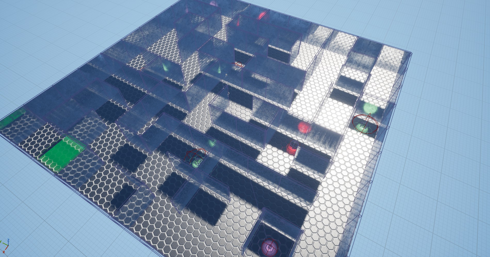
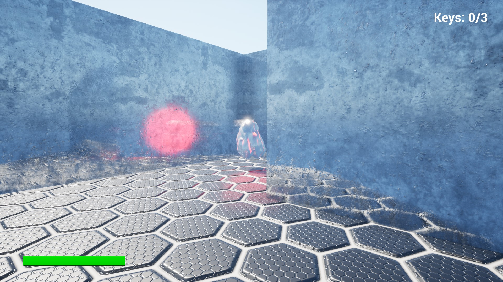
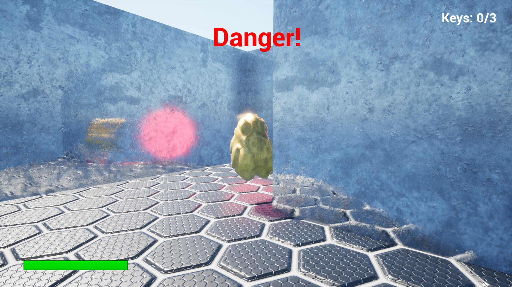
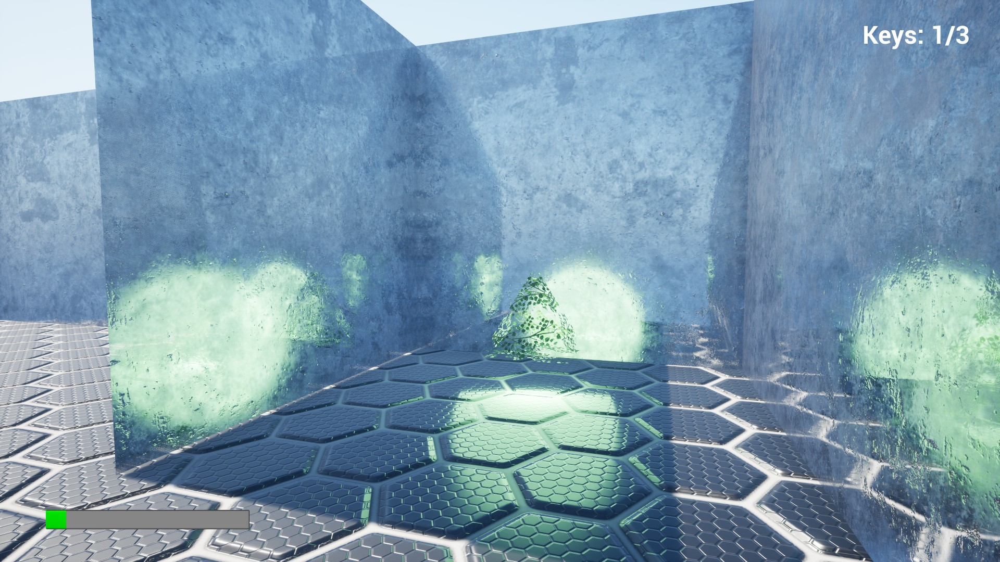
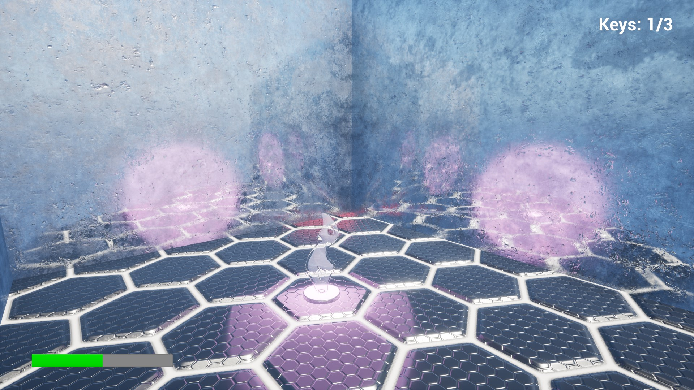
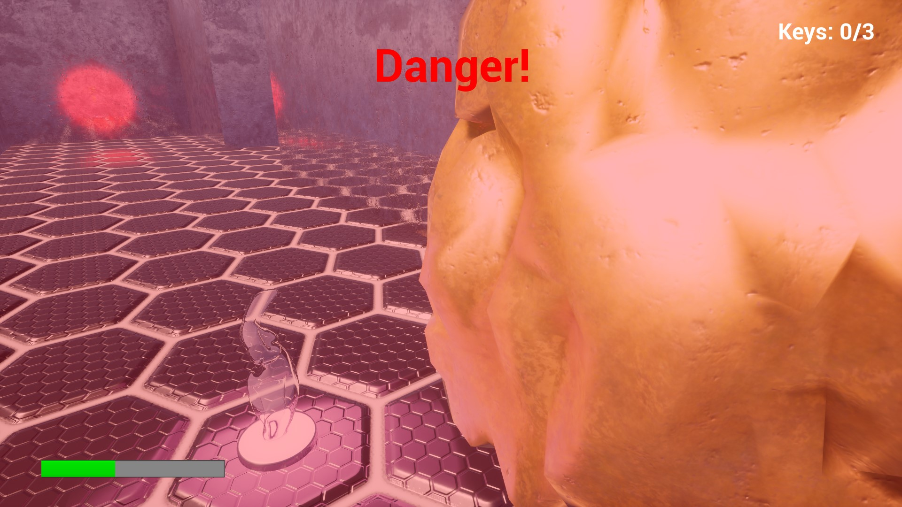
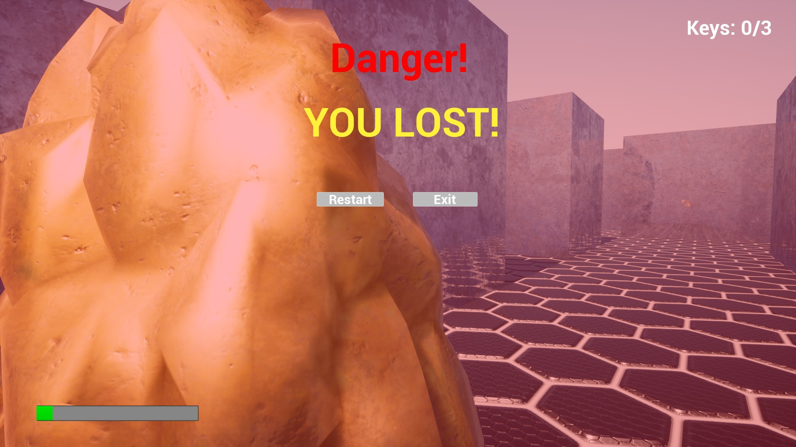
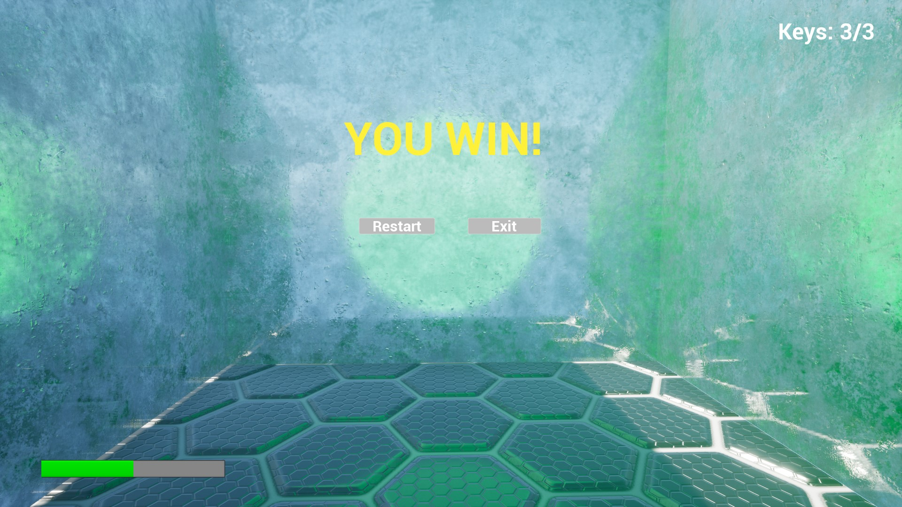
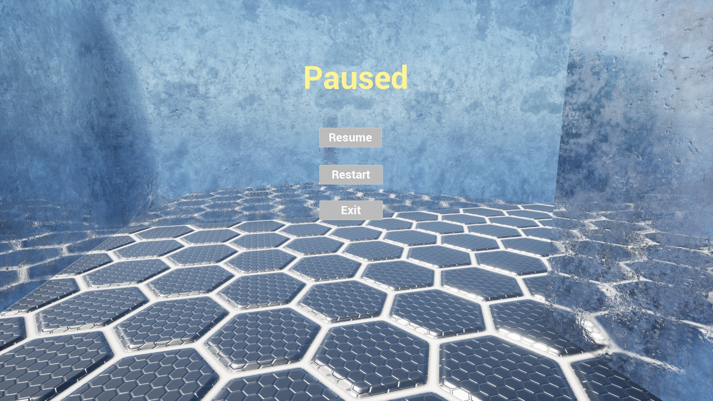
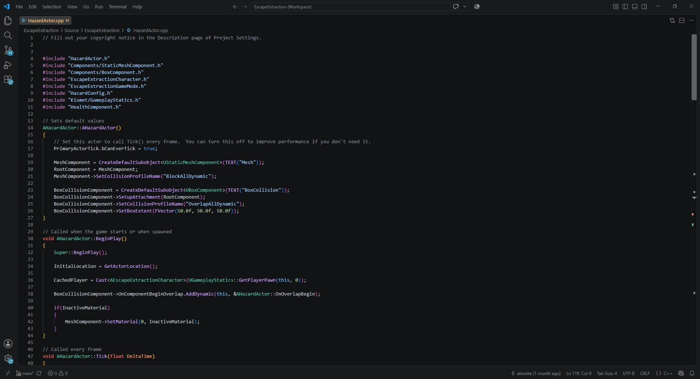

# Escape Extraction

Небольшая игра на Unreal Engine 5 для портфолио.

## Что это

Нужно собрать 3 ключа на уровне и дойти до зоны эвакуации. Если здоровье кончится — проигрыш. Если дойдёшь с ключами — победа.

## Управление

- WASD — движение
- Мышь — камера
- Space — прыжок
- Escape — пауза

## Что реализовано

- Персонаж от первого лица
- Система здоровья с полоской в HUD
- Ключи и аптечки
- Ловушки, которые активируются при приближении и преследуют игрока
- Победа, поражение, рестарт
- Меню паузы
- Звуки шагов, урона и лечения
- Красный экран при уроне, зелёный при лечении

## Технологии

Unreal Engine 5.6, C++(основная логика), Blueprint(для UI, звуков и эффектов), DataAsset(настройка баланса ловушек).

## Скриншоты и видео

[Ссылка на YouTube](https://youtu.be/ducnEOf2lqw) - 2 минуты, показывает весь геймплей

## Скачать

[Ссылка на Google Drive](https://drive.google.com/file/d/1tEWpGDCybu7dlfBqDH-X8pq1K_WMJycf/view?usp=sharing)

**Платформа:** Windows 64-bit  

Распакуй архив и запусти `EscapeExtraction.exe`.

## Ограничения

- Один уровень (без сохранений).
- Нет настроек графики и управления.
- Только Windows 64-bit.

## Контакты

GitHub: [EduardNarezhnev](https://github.com/EduardNarezhnev)